<div align="center">

# 광고는 정말 구매를 늘렸을까?

**마케팅 캠페인 A/B 테스트 분석 · 검정, 효과크기, 비용으로 내린 광고 집행 결정**

`588,101명 실험` · `전환율 +0.77%p` · `p < .001` · `보수적 ROI 약 260%`

</div>

> **한 줄 결론** 광고는 구매 전환율을 **+0.77%p(상대 1.43배)** 높였고 이 차이는 우연이 아니다(p < .001). 효과크기는 작지만 약 56만 명 규모에 곱하면 광고비보다 훨씬 더 벌어들이므로, **기준 가정 하에서 조건부 출시**를 제안한다.


| 데이터셋         | [중] 마케팅 캠페인 A/B 테스트 데이터셋 |
| 데이터셋 출처     | [Marketing A/B Testing · Kaggle](https://www.kaggle.com/datasets/faviovaz/marketing-ab-testing) 
                    (내려받은 날짜 2026-11-08) 
| 분석 노트북 | [`ab_test_marketing.ipynb`](ab_test_marketing.ipynb) 제출용 · [`ab_test_marketing_learning.ipynb`](ab_test_marketing_learning.ipynb) 학습 과정 전체 
| AIFFEL 데이터 인텔리전스 · [통계적 검정과 인과추론] 종합 과제 
| 분석자 | 2기 박근아
---

## 📊 발표 자료

**두 가지 발표 자료를 만들었다.** 하나는 결과만 담은 보고용, 하나는 단계마다 배운 개념까지 담은 학습 공유용이다. 두 PPT 모두 슬라이드마다 **발표 멘트(슬라이드 노트)** 가 들어 있다.

| 자료                    | 구성                                               
| **분석 결과 발표** · 13장 | 결론 → 설계 → 데이터 → 검정 → 결과 → 비용 → 결정 → 한계 
| [PDF로 보기](slides/ab_test_results.pdf) · [PPT 내려받기](slides/ab_test_results.pptx) 

| **학습 과정 발표** · 25장 | 결과 슬라이드 + 📒 학습 노트 12장 (인과 해석, SRM, 0의 벽, Wilson, ROI·CPM 등) 
| [PDF로 보기](slides/ab_test_learning.pdf) · [PPT 내려받기](slides/ab_test_learning.pptx) |

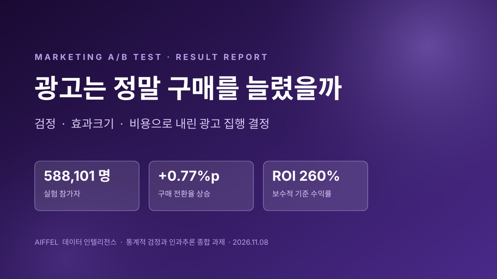
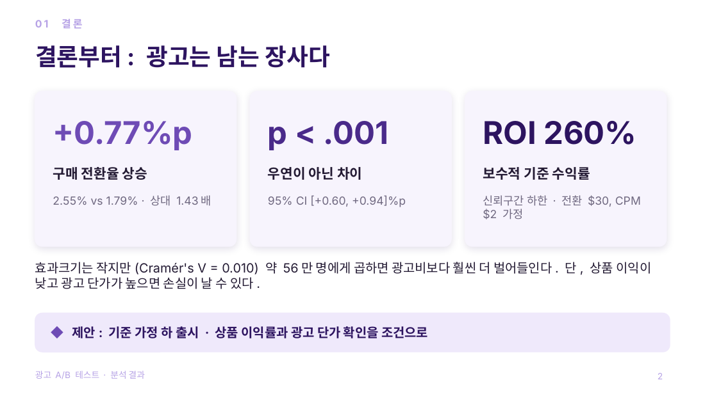

<details>
<summary><b>분석 결과 슬라이드 전체 보기</b></summary>

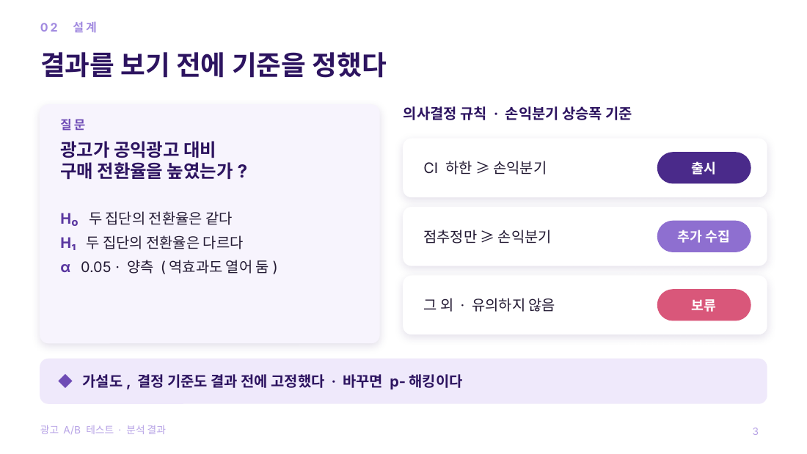
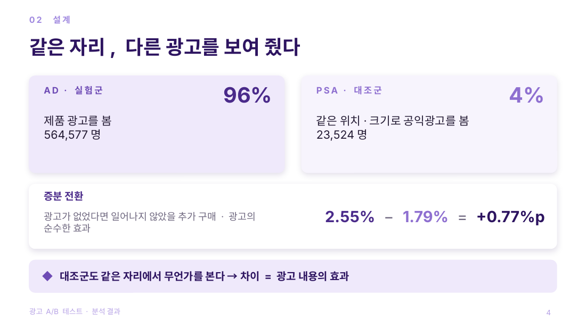
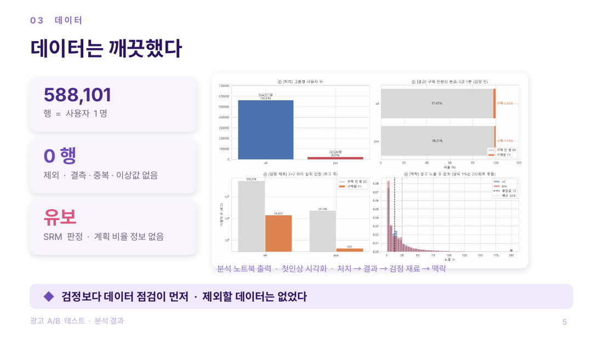
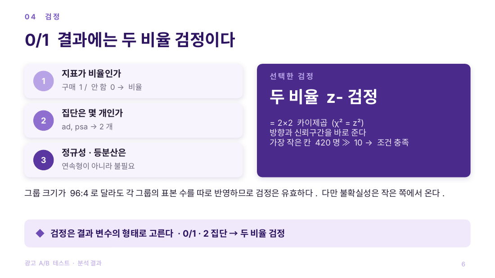
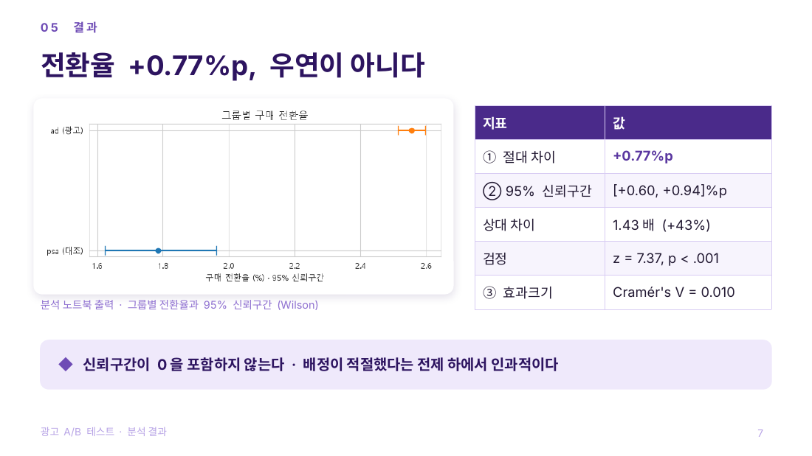
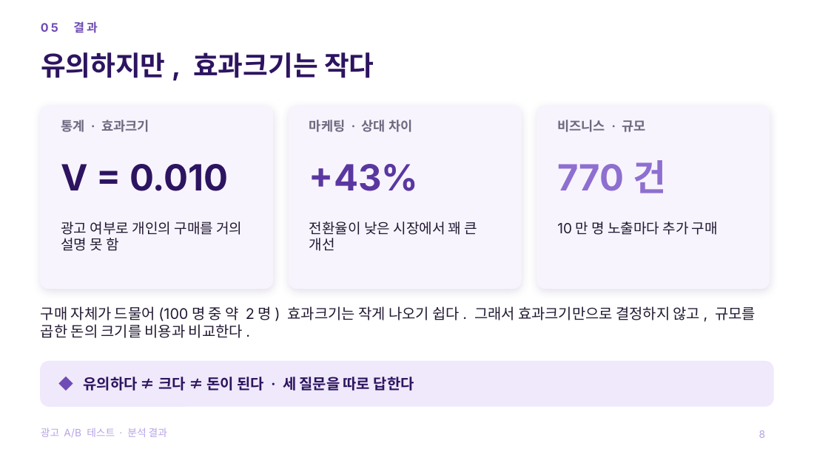
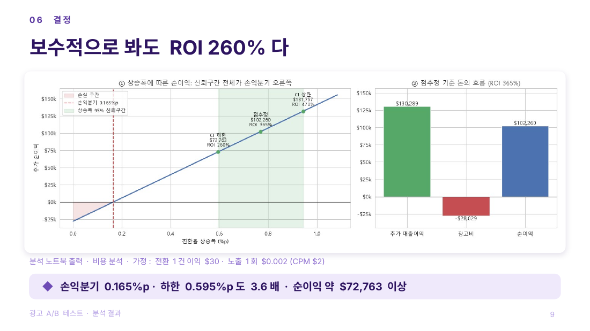
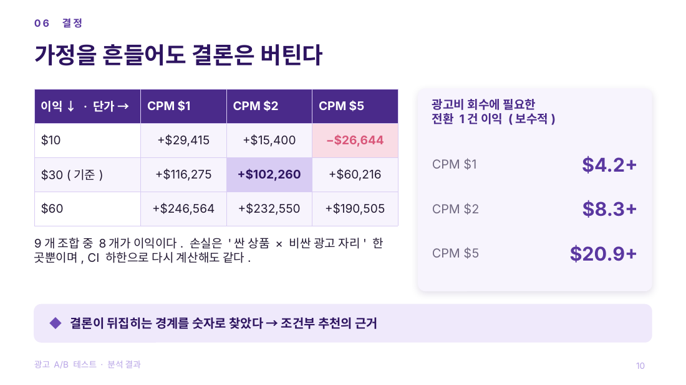
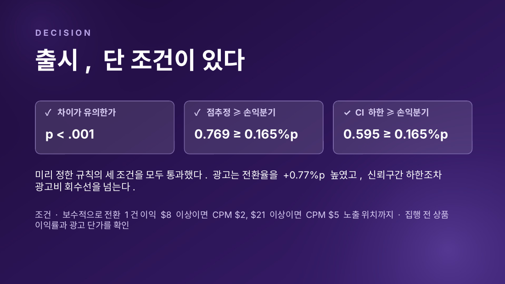
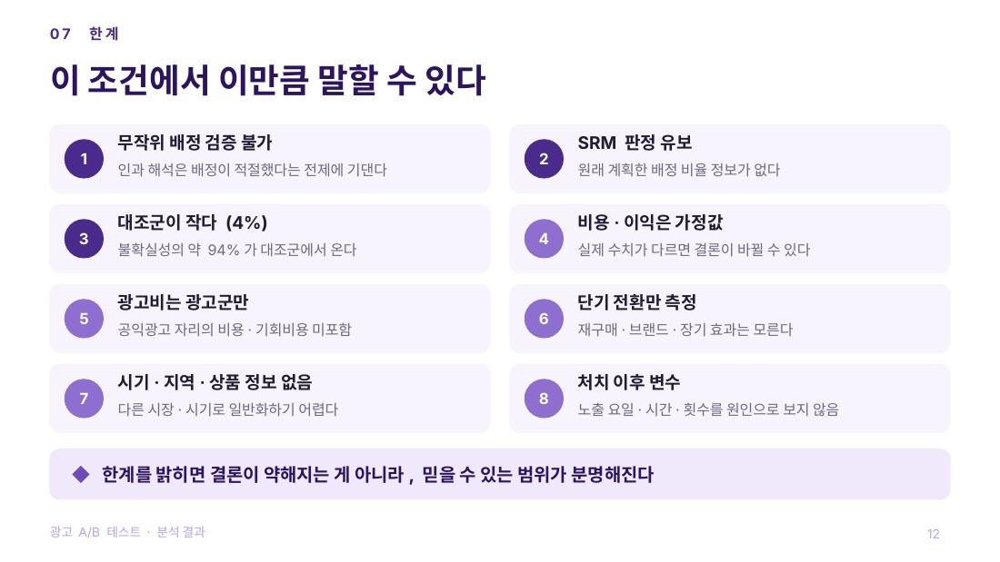

</details>

<details>
<summary><b>학습 노트 슬라이드 미리 보기</b></summary>

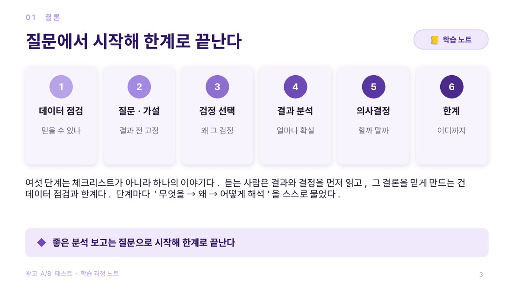
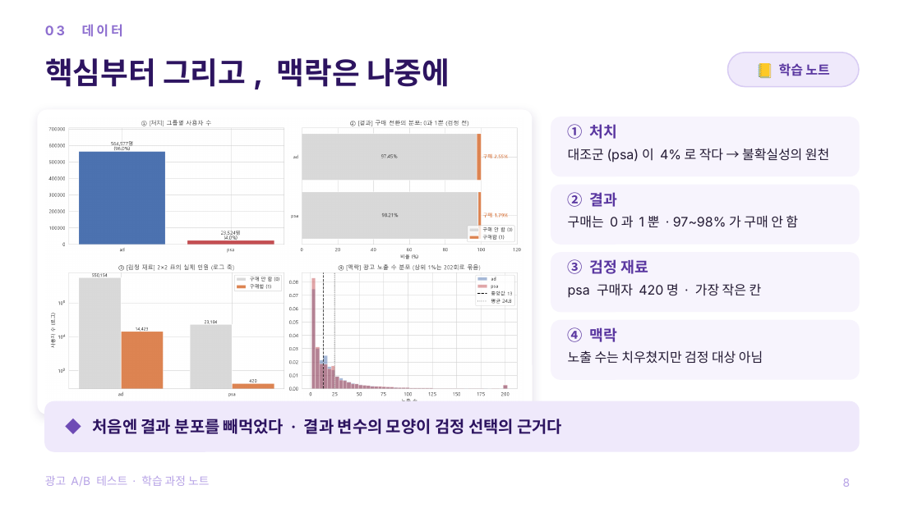
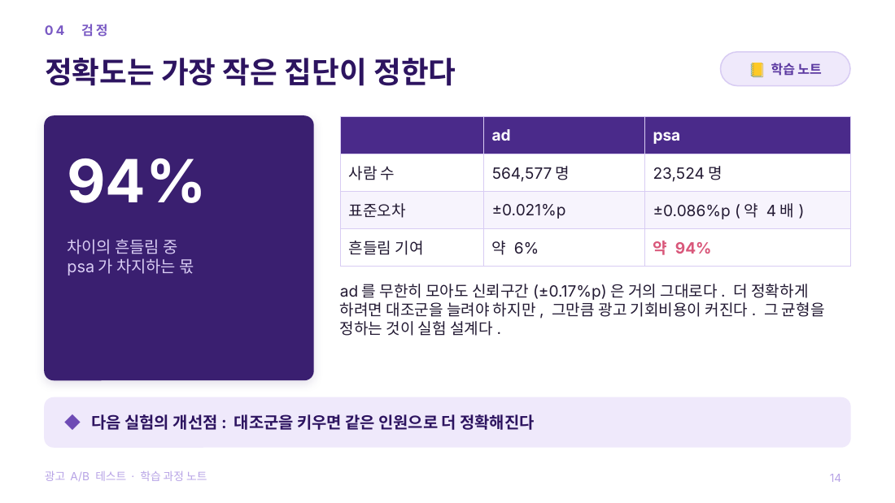
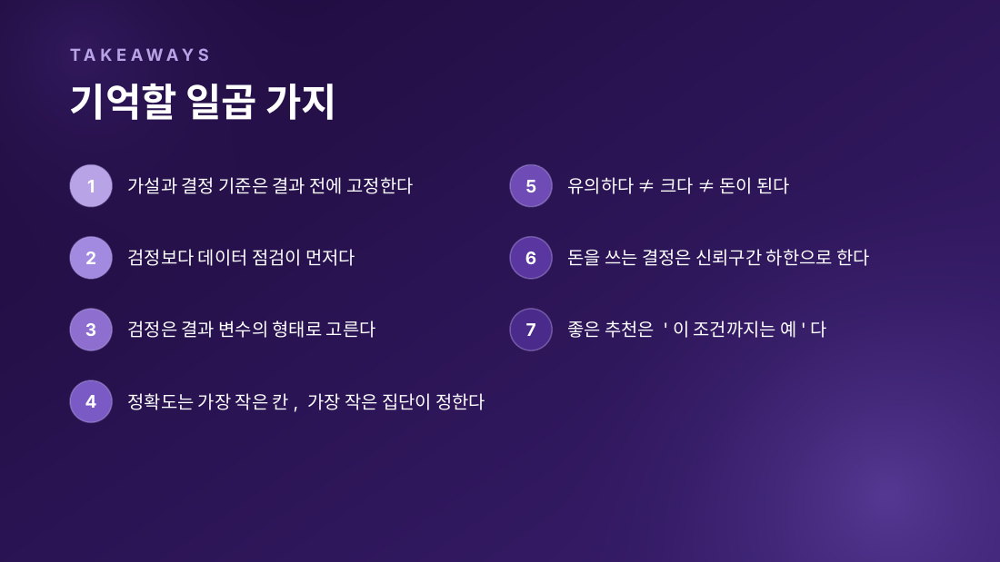

</details>

---


## 1. 왜 이 질문인가

**광고 효과를 가장 확실하게 확인하는 방법은 무작위 실험(A/B 테스트)이다.** 광고를 본 사람이 많이 샀다고 광고 덕분이라고 말할 수는 없다. 원래 살 사람이 광고를 더 많이 봤을 수도 있기 때문이다. 실험이 어려울 때는 이중차분법·성향점수매칭 같은 준실험 방법도 쓰지만, 그 결론은 더 강한 가정에 기댄다.

이 데이터는 사용자의 96%에게 **제품 광고(ad)** 를, 4%에게 같은 위치·크기로 **공익광고(PSA)** 를 보여 준 실험이다. 대조군도 같은 자리에서 무언가를 보므로, 두 집단의 차이는 광고가 없었다면 일어나지 않았을 추가 구매, 즉 **광고 내용이 만든 증분 전환**이다.

→ **정리** 같은 자리에서 내용만 다르게 비교했기 때문에, 광고 내용의 효과를 읽을 수 있다.


## 2. 질문과 가설

**가설과 결정 기준을 결과를 보기 전에 고정했다.** 결과를 본 뒤 기준을 바꾸면 원하는 결론에 맞춘 판단, 즉 p-해킹이 되기 때문이다.


| 질문 | 광고가 공익광고 대비 구매 전환율을 높였는가? 
| 주 지표 | 구매 전환율 (`converted`, 0/1) 
| H₀ / H₁ | 두 집단의 전환율은 같다 / 다르다 
| 유의수준 | α = 0.05, 양측 

| 의사결정 규칙 (손익분기 상승폭 기준) | 결정 

| 95% 신뢰구간 **하한** ≥ 손익분기   | **출시** 
| 점추정만 ≥ 손익분기                | 추가 수집 
| 그 외, 또는 유의하지 않음          | 보류 

→ **정리** 결정은 미리 정한 규칙이 내리고, 분석가는 그 규칙을 따른다.


## 3. 데이터 점검

**데이터는 깨끗했고, 제외한 행은 없다.** 검정보다 점검을 먼저 했다.

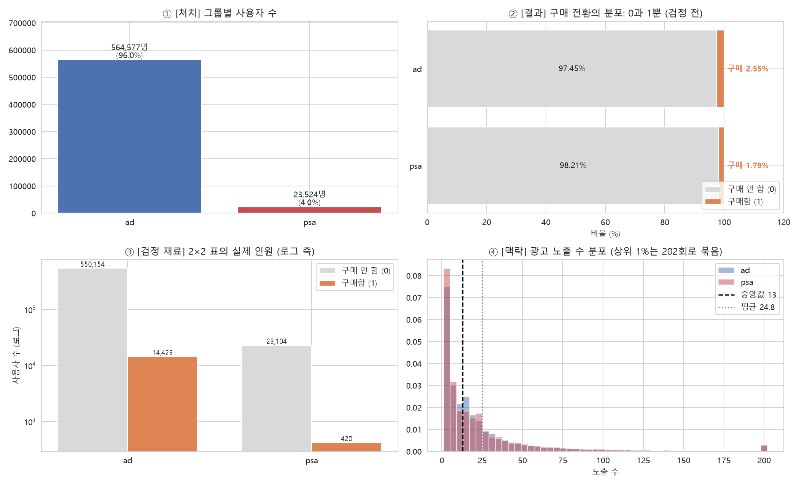

| 점검               | 결과 
| 행 수              | 588,101 → 588,101 (제외 0행) 
| 결측치 · 중복 사용자 | 0 · 0 
| 그룹 라벨 · 값 범위 | ad / psa 두 개 · 노출 수 최소 1, 시간 0~23, 요일 7개 
| 배정 비율          | ad 96.0% (564,577명) : psa 4.0% (23,524명) → **SRM 판정 유보** 

- **SRM을 유보한 이유** 배정 점검은 *계획한 비율*과 비교해야 하는데, 그 정보가 없다. 실제 96:4로 기대 비율을 만들면 순환논리다.
- **노출 수** 오른쪽으로 크게 치우쳤지만(평균 24.8 > 중앙값 13, 최대 2,065) 검정 대상이 아니고 처치 이후 변수라 지우거나 통제하지 않았다. 두 그룹의 평균 노출 수가 같아(24.8회), 두 그룹은 **얼마나 봤는가는 같고 무엇을 봤는가만 다르다.**

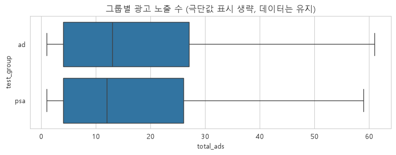

→ **정리** 데이터는 그대로 쓸 수 있었고, 배정이 적절했는지만은 확인할 수 없었다.


## 4. 검정 선택

**결과가 0/1이고 집단이 둘이라 두 비율 z-검정을 골랐다.** 비율 지표라 정규성·등분산 가정이 필요 없고, 2×2 카이제곱과 같은 결론(χ² = z²)이면서 방향과 신뢰구간을 바로 준다.

| 그룹 | 구매 안 함 | 구매함 | 전환율 |
|---|---|---|---|
| ad | 550,154 | 14,423 | 2.55% |
| psa | 23,104 | **420** | 1.79% |

- 가장 작은 칸(psa 구매자)도 420명이라 정규분포 근사 조건(각 칸 10명 이상)을 충족한다.
- 그룹 크기가 달라도 검정은 유효하지만, 차이의 불확실성 중 **약 94%는 작은 대조군**에서 온다.

→ **정리** 검정은 결과 변수의 형태가 정하고, 정확도는 가장 작은 집단이 정한다.


## 5. 결과

**광고군의 전환율이 0.77%p 높았고, 우연이 아니다.** 다만 효과크기는 아주 작다.

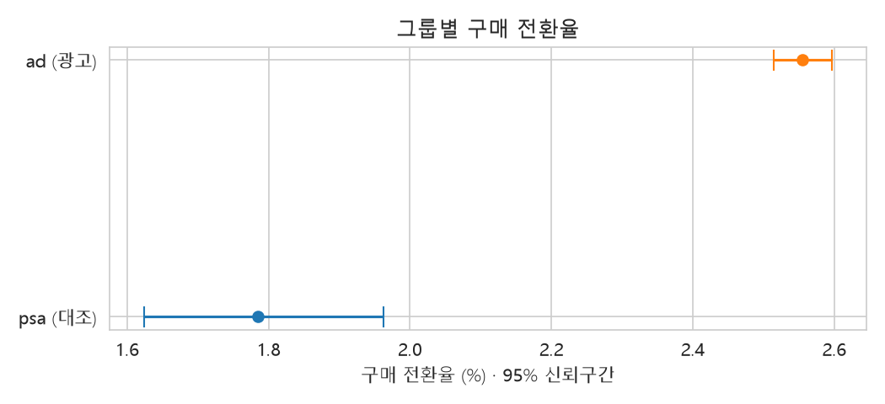

| 지표           | 값 

| ① 절대 차이    | **+0.77%p** (2.55% vs 1.79%) 
| ② 95% 신뢰구간 | [+0.60, +0.94]%p 
| 상대 차이      | 1.43배 (+43%) 
| 검정          | z = 7.37, p < .001 
| ③ 효과크기     | Cramér's V = 0.010, Cohen's h = 0.053 

- 구매 자체가 드물어(100명 중 약 2명) 광고 여부로 개인의 구매를 설명하는 힘은 작다.
- 하지만 10만 명에게 노출하면 약 **770건**의 추가 구매다. 그래서 유의성·크기와 별도로 **돈이 되는지**를 따졌다.
- 이 해석은 **배정이 적절했다는 전제 하에서** 인과적이다.

→ **정리** 유의하다 ≠ 크다 ≠ 돈이 된다. 세 질문을 따로 답한다.


## 6. 비용 분석과 의사결정

**보수적으로 봐도 ROI는 약 260%이고, 결정은 조건부 출시다.** 실제 광고비 자료가 없어 전환 1건 이익 $30, 노출 1회 $0.002(CPM $2)를 기준 가정으로 두었다.

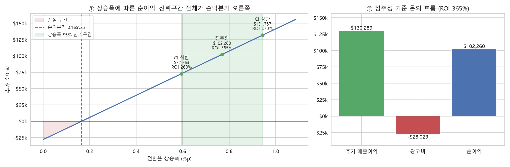

| 시나리오     | 상승폭    | 추가 구매   | 순이익    | ROI 
| 손익분기     | 0.165%p  | 약 934건   | $0       | 0% |
| 신뢰구간 하한 | +0.595%p | 약 3,360건 | $72,763  | 약 260% 
| 점추정       | +0.769%p | 약 4,343건 | $102,260 | 약 365% 

| 전환 이익 ↓ · 광고 단가 → | CPM $1    | CPM $2       | CPM $5 
| $10                    | +$29,415  | +$15,400      | **−$26,644** 
| $30                    | +$116,275 | **+$102,260** | +$60,216 
| $60                    | +$246,564 | +$232,550     | +$190,505 

- 9개 조합 중 8개가 이익이고, **싼 상품 × 비싼 광고 자리**에서만 손실이다.
- 미리 정한 규칙의 세 조건(유의성, 점추정, 신뢰구간 하한)을 모두 통과했다.

> **결정 · 출시 (조건부)** 보수적으로 봐도 전환 1건 이익이 **약 $8 이상이면 CPM $2**, **약 $21 이상이면 CPM $5** 노출 위치까지 광고비보다 더 벌어들인다. 집행 전 상품 이익률과 광고 단가를 먼저 확인한다.

→ **정리** 좋은 추천은 "예/아니오"가 아니라 "이 조건까지는 예"다.


## 7. 한계

**이 결론은 이 조건에서 이만큼 말할 수 있다.**

- 무작위 배정 절차를 독립적으로 검증할 수 없다 (인과 해석은 전제에 기댄다)
- SRM 판정을 유보했다 (계획 비율 정보 없음)
- 대조군이 작다 (4%, 불확실성의 약 94%) → 다음 실험에서는 대조군을 키운다
- 비용·이익은 가정값이고, 광고비는 광고군 노출분만 계산했다
- 단기 구매만 측정했다 (재구매·브랜드·장기 효과는 모름)
- 수집 시기·지역·상품 정보가 없어 일반화에 주의가 필요하다
- 노출 요일·시간·횟수는 처치 이후 변수라 원인으로 해석하지 않았다

→ **정리** 한계를 밝히면 결론이 약해지는 게 아니라, 믿을 수 있는 범위가 분명해진다.


## 8. 다음 실험 제안

**한계마다 보완할 방법이 있다. 가장 먼저 할 일은 실제 비용 데이터를 연결하는 것이다.**

> 광고는 효과가 있고 돈도 남습니다. 다만 지금 숫자는 **추정**이라, 아래 세 가지만 갖추면 **확정**할 수 있습니다.
>
> 1. **실제 광고비와 상품 이익 자료** → "남는다"를 "얼마 남는다"로 확정
> 2. **비교 그룹을 4%에서 10~20%로 확대** → 같은 인원으로 결과가 더 정확해짐
> 3. **재구매까지 지켜보기** → 한 번 팔고 끝나는지, 단골이 되는지 확인
>
> 정리하면, **지금은 집행을 시작하고, 다음 캠페인에서 이 세 가지로 수익을 확정하**는 제안입니다.

가정값, 민감도 분석	> 추정 / 확정
대조군, 검정력 분석	> 비교 그룹, 더 정확해짐
LTV, 가드레일 지표 > 재구매, 단골이 되는지


| 배정 절차를 검증할 수 없다      
> 배정 로그·설계 문서를 남기고, 가입일·과거 구매 같은 **사전 변수**로 두 집단 균형을 점검
인과 해석의 전제를 데이터로 확인      

| SRM 판정 유보                   
> 실험 전 **계획 비율을 문서화**하고, 실험 중 매일 SRM 점검                               
배정 오류를 조기에 발견               

| 대조군이 작다 (4%)              
> **검정력 분석**으로 대조군 비율을 정함 (예: 10~20%)                                     
같은 인원으로 신뢰구간이 좁아짐       

| 비용·이익이 가정값              
> 실제 CPM·주문 이익 데이터를 연결                                                        
민감도 분석 대신 **실제 ROI**         

| 광고비는 광고군만 계산          
> 공익광고 자리의 비용·기회비용까지 **총비용**으로 비교                                   
이익을 과대평가할 위험 제거           

| 단기 구매만 측정                
> 재구매율·고객 생애 가치(LTV)·이탈률을 **가드레일 지표**로 함께 추적                     
단기 이익이 장기 손실을 가리는지 확인 

| 시기·지역·상품 정보 없음        
> 메타데이터를 함께 수집하고, **다른 시기에 재실험**                                      
결과의 재현성과 일반화 확인           

| 노출 빈도를 원인으로 볼 수 없다 
> 빈도가 궁금하면 **노출 상한 자체를 무작위 배정** (예: 하루 5회 vs 10회)                 
최적 노출 빈도를 인과적으로 추정      

**우선순위 (효과가 큰 순)**

| 순위  | 제안                    | 이유                                      
| 1    | 실제 비용·이익 데이터 연결 | 결론(출시)이 가장 크게 기대는 가정을 없앰 
| 2    | 대조군 확대 (검정력 분석)  | 불확실성의 94%가 대조군에서 옴            
| 3    | 장기 지표(재구매·LTV) 추적 | 광고비 집행의 진짜 가치는 장기에서 드러남 

→ **정리** 이번 결론을 더 단단하게 만드는 다음 한 걸음은 **실제 비용으로 ROI를 확정하고, 대조군을 키워 다시 확인하는 것**이다.


## 다시 한 번, 핵심

1. 광고는 구매 전환율을 **+0.77%p** 높였고, 우연이 아니다 (p < .001)
2. 효과크기는 작지만, 규모를 곱하면 **보수적으로도 ROI 약 260%**
3. 결정은 **조건부 출시** · 상품 이익률과 광고 단가가 조건이다
4. 모든 해석은 **배정이 적절했다는 전제** 위에 있다


## 9. 소감

> 분석을 하며 실제로 배우고 느낀 것

**이번 과제에서 가장 크게 배운 것은 "숫자를 구하는 법"보다 "숫자를 믿어도 되는지 묻는 법"이다.**


**질문 자체가 학습이었다.** 
데이터 분석은 아직 개념이 금방 흩어지는 단계에 있다. 그래서 단계마다 멈춰서 "왜?"를 물었다. 왜 네 칸 모두 10명 이상이어야 하는지 물었더니 "0이라는 벽"과 중심극한정리가 연결됐고, 왜 인과적으로 해석해야 하는지 물었더니 질문하며 결정을 하려면 상관이 아니라 인과가 필요하다는 것에 닿았다. 왜 신뢰구간의 폭을 작은 대조군이 정하는지 물었을 때, 계산해 보니 흔들림의 94%가 대조군에서 왔다. 

신뢰구간 = 차이가 흔들리는 폭, 우리가 구한 차이는 “ad 전환율 − psa 전환율”. 표본을 다시 뽑으면 이 차이가 조금씩 달라지는데, 그 흔들림의 폭이 신뢰구간(±0.17%p)

        ad	       psa
사람 수	 약 56만 명	 약 2만 4천 명
흔들림	 ±0.021%p	±0.086%p (약 4배)

합칠 때는 제곱으로 더해서, 큰 쪽이 압도한다. 두 흔들림은 그냥 더하지 않고 제곱해서 더한다. 그래서 큰 쪽이 훨씬 크게 반영된다.
0.021² ≈ 0.0004 · 0.086² ≈ 0.0074 → psa의 몫 = 0.0074 ÷ (0.0004 + 0.0074) ≈ 94%

그래서
광고군을 아무리 더 모아도 신뢰구간은 거의 안 좁아진다. 결과를 더 정확하게 하려면 대조군을 늘려야 한다. 그래서 "다음 실험 제안" 2순위가 대조군 확대. 정리하면, 정확도는 가장 작은 집단이 정한다. 흔들림의 94%가 대조군에서 오기 때문.
사람이 적을수록 더 흔들린다. 전환율의 흔들림(표준오차)은 사람 수가 적을수록 크다.

질문이 생긴 그 자리에서 답을 찾으며, 어렴풋하게나마 데이터 분석의 태도와 흐름이 잡히며, 끝없는 질문 자체가 학습이 되는 과정임을 알았다.


**기억에 남는 순간은 내가 먼저 문제를 발견했을 때다.** 
첫 시각화에 결과 변수(구매 여부)의 분포가 빠져 있다는 걸 짚었고, 다음 셀을 보기 전에 비용 분석을 시각화해야겠다고 먼저 생각했다.


**두 AI를 교차검증하며 진행한 것도 배움이었다.** 
한쪽이 놓친 것을 다른 쪽이 짚었다. 계획 비율 없이 SRM을 검정하는 것이 순환논리라는 점, 한정된 시간에는 확장 분석을 하나만 깊게 하는 게 낫다는 점이 그랬다. 그리고 무엇을 남기고 뺄지는 결국 내가 판단했다. 근거가 되지 못하는 삼성전자 사례를 빼고, "실험으로만 확인할 수 있다"는 AI의 과장된 문장을 고쳤다. 도구가 답을 주더라도, **그 답을 믿을지는 분석가가 정한다**는 걸 직접 경험했다.


**"유의하지만 효과크기는 작다"는 결과가 이번 분석의 하이라이트였다.** 
통계만 보면 작은 효과지만, 56만 명에게 곱하니 보수적으로도 ROI 약 260%가 됐다. 유의함, 크기, 돈이 각각 다른 질문이라는 것을 숫자로 이해했고, 그래서 결론도 "출시"가 아니라 "이 조건까지는 출시"로 쓰게 됐다.


**연구자로서의 경험은 분석의 뼈대를 세우는 데 도움이 됐다.** 질문을 먼저 세우고, 한계를 정직하게 적고, 전체를 하나의 이야기로 구조화하는 일이다. 그렇게 안내된 방식으로 처음 보는 개념과 프로세스를 실무처럼 익히는 과정이 재미있고 유익했다. 물론 아직은 초벌이라, 반복해서 적용하는 것이 남은 과제다.


**다음에 해 보고 싶은 것** 실제 비용 데이터로 ROI를 확정하는 것, 그리고 리뷰 분석 프로젝트로 숫자 뒤의 '왜'를 찾는 것.


**정리하면, 이번 과제는 숫자 앞에서 질문하고, 가정을 밝히고, 조건을 붙여 결정하는 연습이었다.**


---


## 재현 방법

```bash
python -m venv .venv
# Windows: .venv\Scripts\activate   |   macOS/Linux: source .venv/bin/activate
pip install -r requirements.txt
# data/README.md 안내대로 marketing_AB.csv를 data/ 폴더에 둔 뒤 노트북 Run All
```

```
ab-test-marketing/
├── README.md                          # 이 보고서
├── ab_test_marketing.ipynb            # 제출용 분석 노트북
├── ab_test_marketing_learning.ipynb   # 학습 과정 전체 (질문·개념·해석 기록)
├── slides/                            # 발표 자료 · PPT와 PDF (슬라이드 노트에 발표 멘트)
├── figures/                           # 노트북 그림 + 슬라이드 이미지
├── make_submission.py                 # 학습용 → 제출용 노트북 변환
├── requirements.txt
└── data/README.md                     # 데이터 내려받는 방법 (원본 CSV는 업로드하지 않음)
```
