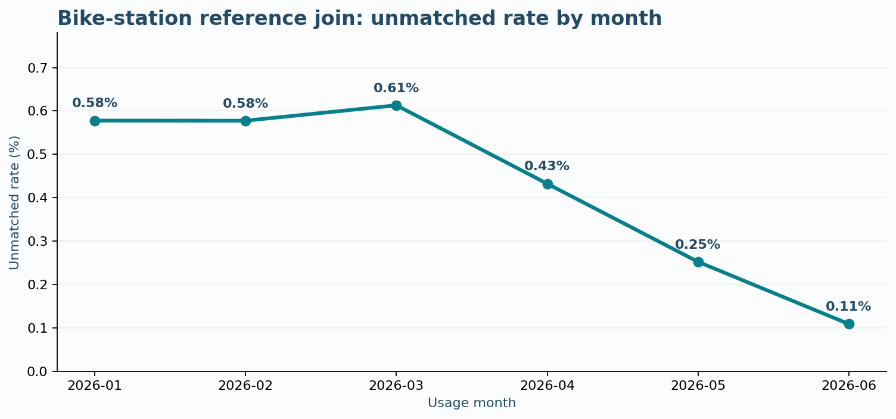

# 공공데이터는 공개되면 바로 활용할 수 있을까?

> **AIFFEL D011 | 웹 스크래핑 · 데이터 랭글링 · 탐색적 데이터 분석(EDA)**  
> 2026-10-29 분석 / 2026-10-30 발표 / **실제 자료 2종의 연결 가능성 검증 사례**



## 핵심 결과 (Executive Summary)

| 구분 | 직접 실행으로 확인한 값 |
|:--|--:|
| 서울시 공공자전거 월별 이용기록 | **16,624행** |
| 2026년 6월 대여소 기준정보의 유효 행 | **2,789행** |
| 대여소 번호 연결 성공 | **16,553행 (99.57%)** |
| 기준정보 미연결 | **71행 (0.43%)** |
| 미연결 고유 대여소 | **20개** |
| 미연결 행의 대여건수 합계 | **43,994건 (전체의 0.245%)** |
| 미연결 행의 반납건수 합계 | **44,570건 (전체의 0.249%)** |

**핵심 해석:** 두 데이터는 대부분 연결됩니다. 그러나 일치하는 행만 남기는 결합을 할 경우, 위 이용량이 *기준정보와 연결된 분석에서 제외될 가능성*이 있습니다. 이용기록 자체가 사라졌다는 뜻은 아닙니다. 사용한 `left join`은 원본 이용기록을 보존합니다. **실제 불일치 원인은 아직 밝혀지지 않았으며, 제안한 품질관리 기법은 기존에 널리 쓰이는 방법**입니다.

## 1. 문제 인식 · 문제 발굴 과정

출발 질문은 **AI를 도입하는 기업·공공기관이 실질적 성과를 내는 데 걸리는 병목 중 무엇을 데이터로 검증하고 개선할 수 있는가**였습니다. 그러나 현장 문제를 검증하기 전 데이터 접근이 쉬운 사례로 여러 차례 이동한 설계상의 한계가 있었습니다. 이 과정은 숨기지 않고 아래에 기록합니다.

| 탐색 단계 | 자료·방법 | 실제 확인 | 범위 변경의 이유 및 한계 |
|:--|:--|:--|:--|
| 1. 기업 수요 확인 | 한국표준협회(KSA) 공고의 HTML을 `requests`와 `BeautifulSoup`으로 수집 | A~E 기업의 실제 과제 5건 | 5건은 모집단 분석에 부족. 기존 KSA 대응과 중복될 위험도 확인 |
| 2. 정부 정책 과제 | 「AI 분야 규제합리화 로드맵」 PDF 표 추출 | 정부 발표 과제 총 67건, 분야·연도별 분포 탐색 | PDF 병합 셀로 자동 추출 오류 발생; AI 전사 CSV 사용, **전 항목 독립 검증 미완료** |
| 3. 검증 대상 탐색 | 공공데이터 활용성 관련 10개 과제 검토 | 19·24번을 실증 배경의 우선 검토 후보로 도출 | 중요도 순위나 이행 완료 판단은 아님 |
| 4. 실제 데이터 검증 | 서울시 따릉이 기준정보 및 월별 이용정보 | 16,624건의 연결 성패·이용량 영향 측정 | **정부 정책 효과나 기업 AI 도입 병목을 직접 검증하는 분석은 아님** |

**프로젝트 성격:** 문제 해결을 주장하는 사업 포트폴리오가 아닌, 실제 공개데이터를 활용한 **데이터 접근성·정합성 검증과 분석 위험 예방 실증 보고서**입니다. 최초의 포괄적인 산업 문제는 해결하지 못했습니다.

## 2. 실증 문제 정의와 분석 질문

- **대상:** 서울시 공공자전거 공개 데이터를 결합하는 분석 담당자.
- **구체적 문제:** 두 파일의 대여소 식별자 표현 및 기준 시점이 달라 기록 일부가 연결되지 않을 수 있습니다.
- **분석 질문 Q1:** 번호를 정규화한 후 몇 행이 연결되는가?
- **Q2:** 연결 실패는 몇 개의 고유 대여소와 어떤 월에 집중되는가?
- **Q3:** 미연결 행을 일치 결합으로 제외할 경우 대여·반납건수 분석에서 어느 정도가 빠질 수 있는가?
- **성공 기준(이 실증의 범위):** 결합 여부와 잠재 누락 규모를 **재현 가능하게 측정**하고, 제외하지 않고 보존하는 처리 방식을 검증한다. **미연결 원인 제거 및 운영 개선 효과 검증은 범위 밖**이다.

## 3. 원본 데이터: 수집 웹사이트·수집 항목·선정 이유

| 자료 | 공식 웹사이트 | 기준시점·원본 형식 | 수집·확인 항목 | 선정 이유 |
|:--|:--|:--|:--|:--|
| KSA AI 과제 공고 | [한국표준협회 2026년 공고](https://www.ksa.or.kr/bbs/ksa_kr/1021/1590667/artclView.do) | 2026년 공고 HTML | 기업 구분, 업종, 구축 과제, 구축비용 표시 | 기존 수요·기존 서비스 탐색 및 HTML 스크래핑 실습 |
| AI 규제합리화 로드맵 | [방송미디어통신위원회 게시 공식 PDF](https://www.kmcc.go.kr/download.do?fileSeq=62128) | 2025-11-27 / PDF 65쪽 | 정책 과제명, 분야, 부처, 계획연도 | 정부가 기존에 인식하고 대응 중인 문제 확인 |
| 서울시 공공자전거 대여소 정보 | [서울 열린데이터광장](https://data.seoul.go.kr/dataList/OA-13252/F/1/datasetView.do) | 2026년 6월 기준 XLSX | 대여소 번호, 대여소명, 위치, 운영 정보 | 월별 이용기록을 연결할 기준정보 |
| 서울시 공공자전거 대여소별 이용정보(월별) | [서울 열린데이터광장](https://data.seoul.go.kr/dataList/OA-15249/F/1/datasetView.do) | 2026년 1~6월 CSV | 자치구, 대여소명, 기준년월, 대여건수, 반납건수 | 실제 결합 성공률과 잠재 누락 규모 계산 |

**수집 방식 구분:** KSA 공고는 `requests` + `BeautifulSoup`으로 HTML을 직접 수집했습니다. 정부 PDF는 HTTP 다운로드 후 PyMuPDF로 구조를 점검했습니다. 서울시 XLSX·CSV는 **사용자가 공식 사이트에서 직접 내려받았으며**, Python은 해당 로컬 파일을 읽어 분석했습니다. 따라서 모든 자료를 '웹 스크래핑'으로 수집했다고 주장하지 않습니다.

## 4. 주요 코드 · 사용 이유 · 검증

### 4-1. HTML 수집과 표 추출

```python
response = requests.get(url, headers={"User-Agent": "Mozilla/5.0"}, timeout=15)
response.raise_for_status()
soup = BeautifulSoup(response.text, "html.parser")
rows = soup.find_all("table")  # 원문 구조 확인 뒤 대상 표를 선별
```

**이유:** HTTP 응답·HTML 원문을 먼저 확보한 뒤 표 구조로 실제 수요를 확인. **검증:** HTTP 200, 공고 키워드 포함, A~E 5개 기업 행 검출. 병합된 비용 셀(`rowspan=3`)은 임의로 채우지 않았습니다.

### 4-2. XLSX 표 구조 점검과 식별자 정규화

```python
base["station_id"] = pd.to_numeric(base.iloc[:, 0], errors="coerce").astype("Int64")
base_clean = base[base["station_id"].notna()].copy()
usage["station_id"] = pd.to_numeric(
    usage["대여소명"].astype(str).str.extract(r"^\s*(\d+)\s*\.", expand=False),
    errors="coerce"
).astype("Int64")
```

**이유:** XLSX의 여러 머리글 행과 CSV 대여소명 내부 번호 표현을 공통 식별자로 변환. **검증:** 기준정보 유효 2,789행, 번호 중복 0, 이용정보 번호 추출 실패 0. XLSX 처음 3개 행의 머리글은 품질 불량 데이터로 오인하지 않았습니다.

### 4-3. 안전한 결합과 누락 진단

```python
joined = usage.merge(
    base_unique[["station_id", "기준대여소명"]],
    on="station_id", how="left", indicator=True, validate="many_to_one"
)
unmatched = joined.loc[joined["_merge"] == "left_only"].copy()
```

**이유:** 이용기록을 보존하고, `indicator`로 미연결 행을 표시하며, `validate`로 기준정보의 식별자 유일성을 검사. **검증:** 16,624행을 보존, 71행 미연결, 20개 고유 대여소. 원본 파일 덮어쓰기 없음.

### 4-4. 잠재 누락 규모 측정

```python
for metric in ["대여건수", "반납건수"]:
    val = pd.to_numeric(joined[metric].astype(str).str.replace(",", "", regex=False), errors="coerce")
    total = val.sum()
    affected = val[joined["_merge"] == "left_only"].sum()
    print(metric, affected, round(affected / total * 100, 3))
```

**이유:** 미연결된 **행 비율**이 실제 **이용량 비율**과 같다는 가정을 피하기 위함. **검증:** 두 지표 모두 숫자 변환 실패 0. 기술통계의 합계와 비율만 사용했고, 인과분석이나 유의성 검정은 실시하지 않았습니다.

## 5. EDA 결과와 시각화

### 5-1. 월별 결합 품질


| 월 | 전체 이용 행 | 미연결 행 | 미연결률 |
|:--|--:|--:|--:|
| 2026-01 | 2,769 | 16 | 0.58% |
| 2026-02 | 2,770 | 16 | 0.58% |
| 2026-03 | 2,773 | 17 | 0.61% |
| 2026-04 | 2,776 | 12 | 0.43% |
| 2026-05 | 2,776 | 7 | 0.25% |
| 2026-06 | 2,760 | 3 | 0.11% |
| **합계** | **16,624** | **71** | **0.43%** |

**관찰:** 3월 0.61%에서 6월 0.11%로 낮아집니다. **가설:** 6월의 기준정보와 과거 이용실적 사이 시점 차이가 원인일 수 있습니다. 그러나 대여소 변경 이력 확인 전까지 원인이라고 단정할 수 없습니다.

### 5-2. 업무적 영향

- 미연결 행의 대여건수는 **43,994건 / 총 17,978,894건(0.245%)**입니다.
- 미연결 행의 반납건수는 **44,570건 / 총 17,884,983건(0.249%)**입니다.
- `inner join` 방식으로 미연결 행을 제거했다면 기준정보와 연결된 집계에서는 위 규모의 이용량이 빠질 수 있습니다. 실제로 적용한 `left join`은 원본 이용 행을 보존합니다.

## 6. 인사이트 · 실행 대안 · 한계

**인사이트 1.** 두 공개 자료의 연결 가능성은 99.57%로 높습니다. 이번 결과를 근거로 서울시 공공데이터의 품질이 전반적으로 나쁘다고 말할 수 없습니다.

**인사이트 2.** 미연결 기록의 개수와 그 기록이 차지하는 실제 이용량을 분리해 측정해야 합니다. 0.43%의 미연결 행은 0.245%의 대여건수에 해당합니다.

**인사이트 3.** 기준정보 한 시점과 여러 달의 이용 실적을 연결할 때, **기준시점 차이**가 중요한 검토 요인입니다. 다만 20개 대여소의 신설·폐쇄·이전 기록은 확보하지 못했습니다.

**실제 실행:** 기존 데이터 엔지니어링 기법인 식별자 정규화, `left join`, 결합 무결성 검증, 미연결 목록 분리·영향 측정을 적용했습니다. 이는 **새로운 방법 개발이나 기관 운영 문제의 해결을 의미하지 않습니다.**

**후속 실행 제안:** (1) 미연결 20개 대여소에 대한 공식 변경이력 조회 (2) 시점별 기준정보와의 재결합 검증 (3) 정제 전후 누락량·검토시간 측정 (4) 다른 기관 데이터에서도 반복되는지 재현 테스트. 이러한 후속 조치의 효과는 아직 검증하지 못했습니다.

## 7. 사용자 판단·AI 지원 구분

| 구분 | 수행 내역 |
|:--|:--|
| 사용자 직접 판단 | 실무 문제 해결이라는 최상위 목표 제시; KSA 기존 대응 중복 지적; 5건 표본의 한계 지적; 문제 선정 이유 요구; 단순 기술 실습과 해결 성과를 구분하도록 교정 |
| 사용자 직접 실행 | HTML 수집·표 확인, PDF 열람·표 추출, CSV·XLSX 다운로드와 코드 실행, 결합/품질/영향 출력 확인, Jupyter 오류 해결 |
| AI 지원 | 자료 후보 및 코드 초안, 파싱 오류 대응, 데이터 처리·통계·시각화 방법 제안, 보고서 서술 정리 |
| 남은 검증 | 로드맵 67개 CSV 전 항목의 공식 PDF 대조, 미연결 20개 대여소 변경이력, 제안한 프로세스의 운영상 효과 |

## 8. 재현 방법과 파일 구성

- `D011_AI_67_regulatory_roadmap.ipynb`: 정부 PDF 탐색용 **초기 노트북 사본**. 사용자의 PC에 있는 최신 통합 노트북과는 다를 수 있습니다. **업로드 전 최신 로컬 파일로 교체해야 합니다.**
- `eda_reproduce.ipynb`: 따릉이 CSV/XLSX 원본에서 결합·품질 지표를 재계산하기 위한 별도의 재현 노트북.
- `monthly_join_quality.csv`: 직접 실행 결과로 사용자에게서 확인한 월별 요약 수치.
- `figures/monthly_unmatched_rate.png`: 해당 월별 수치로 재작성한 그래프.
- `D011_67_projects_reference_AI_transcribed.csv`: AI가 만든 67건 전사본; **독립 전수 대조 미완료, 정책 이행의 검증된 원본으로 사용 금지**.
- `data_raw/`: 사용자가 공식 사이트에서 내려받은 원본 2종을 로컬에 보관하고 재현 시 여기에 둡니다. 저작권·용량·공개 범위 확인 전에는 공개 저장소에 포함하지 않습니다.

**재현:** Python 환경에 `pandas`, `openpyxl`, `matplotlib`이 필요합니다. 원본 XLSX·CSV를 `data_raw/`에 두고 `eda_reproduce.ipynb`를 실행하세요. 공식 웹사이트에서 파일명이 변경되면 파일 목록 확인이 필요합니다.

## 9. 제출 기록

- GitHub: **업로드 후 실제 브랜치/경로 확인해 입력**
- Notion AI DATA INTELLIGENCE: **GitHub 실제 주소 확인 후 제출**
- 출처 확인일: 2026-10-29
- 제출 상태: **미게시(최종 업로드 확인 전)**
