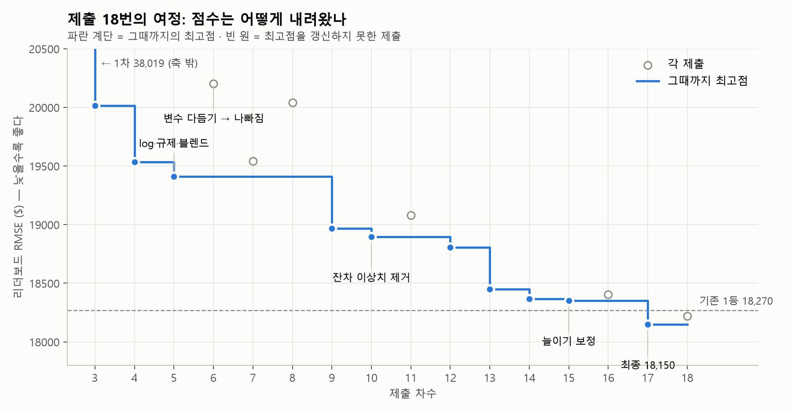
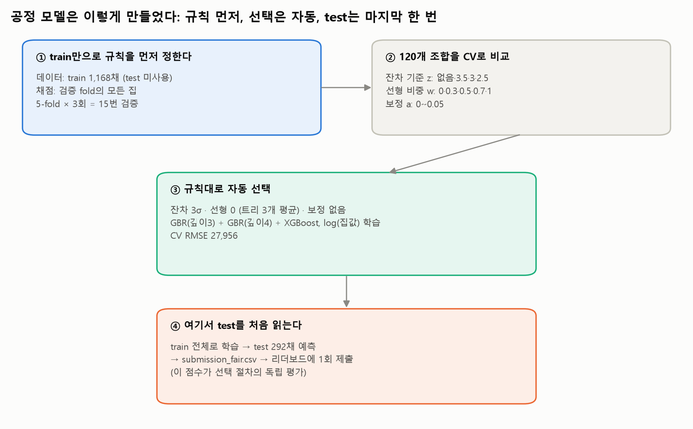
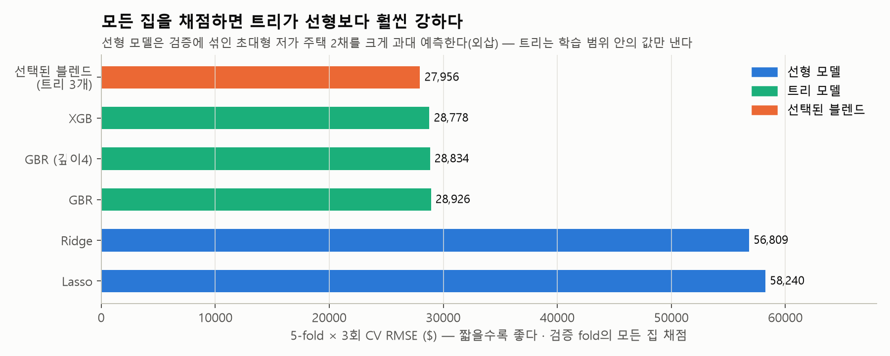

# 🏠 집값 예측 컴피티션: 회귀 모델 개선 기록(38,019에서 20,215까지) — 공정 검증 버전

**AI 데이터 인텔리전스 › 필수 머신러닝 › 집값 예측 컴피티션**

> **[Modulabs-DI2기] House Price Prediction** · 지표 RMSE(달러) · 리더보드는 test 292채 **전체**로 채점
>
> 코드와 실행 결과는 [`House_Prices_최종정리.ipynb`](House_Prices_최종정리.ipynb)에 있다. 이 문서는 **무엇을, 왜 했는지**를 설명한다.

| | 리더보드 RMSE | 비고 |
|---|---|---|
| 🟡 1차 제출 (템플릿 버그 수정 후 LinearRegression) | 38,019 | |
| 🔴 리더보드 튜닝으로 고른 모델 (17차) | 18,150 | **공정하지 않음** — test 정보로 설정을 고름 |
| 🟢 **공정 모델 (1회 제출)** | **20,215** | train CV만으로 자동 선택 · 1차 대비 46.8% 감소 |

> [!IMPORTANT]
> **이 문서의 원칙 — test는 마지막 예측에서 한 번만 읽는다.**
> 모델·이상치 기준·블렌드 비중·보정 강도는 모두 **train만으로**, 실행 전에 정해 둔 규칙에 따라 **교차검증으로 자동 선택**했다.
> test의 정답·분포·리더보드 점수는 어떤 선택에도 쓰지 않았다.

---

## 0. 왜 다시 만들었나 — 리더보드 튜닝이라는 함정



> [!CAUTION]
> **처음 과정의 문제** — 18번의 제출 중 9차 이후는 이상치 기준(3σ·2.5σ·3.5σ), 블렌드 비중, 보정 강도(0.02~0.05)를 **여러 개 제출해 리더보드가 좋은 쪽을 고르는 방식**이었다.
> 리더보드는 test 정답으로 매긴 점수다. 그래서 이 방식은 **test 정답을 간접적으로 보고 모델을 고르는 것**이고, 이 대회 리더보드는 test 전체로 채점하므로 그 점수(18,150)는 '처음 보는 데이터에서의 성능'이 아니다.
> 검증 채점 범위를 test의 면적 분포로 정한 것도 test 정보를 검증 설계에 쓴 것이었다.

그래서 이 선택들을 모두 버리고, **test를 보지 않는 절차**로 모델을 다시 골랐다. 위 그림의 과정은 반면교사로 남긴다.

> [!NOTE]
> **결과** — 공정 모델은 리더보드 **20,215**로, 리더보드 튜닝 모델(18,150)보다 **2,065달러(약 10%) 나쁘다.** 이 차이가 'test에 맞춰 설정을 고른 효과'의 크기이고, 20,215가 test를 보지 않고 고른 이 모델의 실제 실력이다.

---

## 1. 공정 모델 한눈에 보기



---

## 2. 사전 등록한 검증 규칙

교차검증을 **실행하기 전에** 아래 규칙을 정했고, 결과를 보고 바꾸지 않았다.

| 항목 | 규칙 |
|---|---|
| 데이터 | train 1,168채만 사용. test는 최종 예측할 때만 읽는다 |
| 전처리 | 각 fold의 **학습 데이터만으로** 결측 채움 값(중앙값·최빈값)과 원-핫 컬럼을 정한다 (Ch4) |
| 채점 | 검증 fold의 **모든 집**, RMSE(달러). 어떤 집도 채점에서 빼지 않는다 |
| 반복 | 5-fold × 3회 = 15번 검증의 평균 |
| 학습 이상치 | EDA의 '큰데 싼 집' 2채(공사 중 판매)는 항상 제외 + 잔차 기준 후보 z ∈ {없음, 3.5, 3.0, 2.5} |
| 모델 | Ridge(α=3) · Lasso(α=0.0005) · GBR(깊이 3) · GBR(깊이 4) · XGBoost — 모두 log(집값) 학습 |
| 블렌드 | 선형(Ridge·Lasso 평균) 비중 w ∈ {0, 0.3, 0.5, 0.7, 1}, 나머지는 트리 3개 평균 |
| 보정 | 강도 a ∈ {0, 0.01, …, 0.05}, 보정 예측 = p × (p / 163,000)^a |
| 선택 | **CV 평균 최저** 조합. 최저와 50달러 이내 차이면 더 단순한 쪽 |

> [!WARNING]
> **남아 있는 편향 (공개)** — 선택 절차는 test를 쓰지 않지만, **후보 목록**(2.5σ, 보정 0.04, 깊이 4 GBR 등)은 처음 과정에서 리더보드를 보며 얻은 경험으로 만들었다. 이 편향은 지울 수 없다.
> 또 120개 조합 중 CV 최저를 고르므로 선택된 CV 점수(27,956)는 실제보다 **낙관적**일 수 있다. 선택 절차 전체의 독립 평가는 test에 **한 번만** 제출한 리더보드 점수다.

---

## 3. 결과

### ① 템플릿 버그 — test를 보지 않고 재현했다

템플릿은 test를 **test 자신의** 통계로 채우고 따로 인코딩해서 예측이 무너졌다(평균 8.9만 달러, 음수 28개). train을 80:20으로 나눠 검증 데이터에 같은 방식을 쓰면:

| 검증 데이터 처리 방식 | RMSE |
|---|---|
| 템플릿 방식 (검증 데이터 자기 기준) | 100,051 |
| train 기준으로 같은 처리 | 44,238 |

같은 모델인데 전처리 기준만 달라도 RMSE가 두 배 넘게 차이 난다. **채우는 값은 학습 데이터에서만 구하고, 같은 함수를 적용한다.**

### ② 단일 모델 — 모든 집을 채점하면 트리가 강하다



> [!NOTE]
> **외삽** — 학습에서는 '큰데 싼 집' 2채를 뺐지만, 검증 채점에는 그대로 들어간다. 선형 모델은 면적에 비례해 값을 키워 5,642sqft짜리 집을 크게 과대 예측하고, 트리는 학습 범위 안의 값만 내놓아 크게 빗나가지 않는다.
> 처음 과정에서 "선형이 더 강하다"고 본 것은 이 2채를 **가격 기준으로 채점에서 뺀** 결과였다. 정답을 보고 평가 대상을 고르면 모델의 강약 판단까지 달라진다.

### ③ 자동 선택 — 트리 3개 블렌드, 잔차 3σ, 보정 없음

| 후보 | CV RMSE |
|---|---|
| 최고 단일 모델 (XGB) | 28,778 |
| 🟢 **선택: 잔차 3σ · 선형 0(트리 3개 평균) · 보정 없음** | **27,956** |
| ↳ 같은 모델의 리더보드 (1회 제출) | **20,215** |

- **보정은 채택되지 않았다.** 15개 fold 중 8~9개에서만 좋아졌고 평균으로는 나빠졌다. 트리 모델은 예측을 평균 쪽으로 강하게 끌어당기지 않기 때문이다.
- 처음 과정(리더보드 튜닝)의 선택 — 선형 50%, 2.5σ, 보정 0.04 — 과 **다른 결과**가 나왔다. 절차가 리더보드 경험 쪽으로 끌려가지 않았다는 근거다.
- **CV(27,956)보다 리더보드(20,215)가 낮은 이유(사후 해석)** — 공정 CV는 검증 fold의 모든 집을 채점해서, train의 초대형 저가 주택 2채의 큰 오차가 평균을 끌어올린다. 이런 비정상 거래가 적은 데이터에서는 오차가 더 작게 나온다. 이 해석은 제출 후에 한 것이며 모델 선택에는 쓰지 않았다.

---

## 4. 핵심 코드

```python
def make_preprocess(ref):
    """ref(학습 데이터)의 중앙값·최빈값을 기억하는 전처리 함수"""
    median = ref.median(numeric_only=True)
    mode = {col: ref[col].mode()[0] for col in ref.select_dtypes(include="object")}
    def preprocess(df):
        df = df.fillna(median)
        for col, value in mode.items():
            df[col] = df[col].fillna(value)
        return df
    return preprocess

def encode(train_part, other_part):
    """train_part 기준으로 원-핫 인코딩, other_part는 같은 컬럼에 맞춤 (CV의 fold, 최종 test 모두 이 함수)"""
    prep = make_preprocess(train_part)
    X_tr = pd.get_dummies(prep(train_part), drop_first=True).drop(columns=["SalePrice"], errors="ignore")
    X_ot = pd.get_dummies(prep(other_part)).reindex(columns=X_tr.columns, fill_value=0)
    return X_tr.astype(float), X_ot.astype(float)

def outlier_mask(X, y, z):
    """학습에 쓸 집: 큰데 싼 2채 제외 + (z가 있으면) 잔차 z 이상 제외"""
    keep = ~((X["GrLivArea"] > 4000).values & (y < 300000))
    if z is not None:
        Xk, lk = X[keep], np.log1p(y[keep])
        resid = lk - make_pipeline(RobustScaler(), Ridge(alpha=10)).fit(Xk, lk).predict(Xk)
        zz = np.abs((resid - resid.mean()) / resid.std())
        idx = np.where(keep)[0]; keep[idx[zz >= z]] = False
    return keep
```

```python
# 최종: 선택된 설정(z=3.0, w=0, a=0)으로 train 전체 학습 → 여기서 test를 처음 읽는다
test_raw = pd.read_csv(DATA + "test.csv")
X_full, X_test = encode(train_raw, test_raw)
final = FairBlendModel(BEST_Z, BEST_W, BEST_A).fit(X_full, train_raw["SalePrice"])
test_pred = final.predict(X_test)        # GBR·GBR(깊이4)·XGB의 log 예측 평균 → 달러 복원
```

---

## 5. 학습자로서, 분석가로서 배운 것

> [!IMPORTANT]
> **1. test는 마지막에 한 번만 본다.**
> test의 정답은 물론, test의 분포나 **리더보드 점수도** 모델 선택에 쓰면 그 점수는 더 이상 실력을 보여 주지 않는다. 대회 규칙상 허용(하루 39회 제출)되더라도 검증의 독립성은 따로 지켜야 한다.

> [!IMPORTANT]
> **2. 규칙을 먼저 정하고 실험한다.**
> 결과를 보고 기준을 고르면, 운 좋은 설정을 고른 것인지 좋은 설정을 고른 것인지 구분할 수 없다.

> [!TIP]
> **3. train과 test는 같은 함수, 학습 데이터의 통계로 처리한다.** 기준이 다르면 같은 모델도 RMSE가 두 배 넘게 나빠진다.

> [!TIP]
> **4. 교차검증 안에서도 전처리 기준은 fold의 학습 데이터로만 정한다** (Ch4 데이터 누수).

> [!NOTE]
> **5. 모델의 강약은 채점 기준과 데이터 범위에 달려 있다.** 학습 범위 밖의 집이 섞이면 선형 모델은 외삽으로 크게 빗나가고 트리는 안전하다. 어떤 집을 채점할지 정답을 보고 정하면 이 판단 자체가 왜곡된다.

> [!NOTE]
> **6. 제출 전에 예측값을 상식으로 점검한다.** `describe()` 한 줄이 템플릿의 붕괴를 잡았다. 이 점검은 정답 없이 하는 형식 점검이고, 그 결과로 모델을 바꾸지 않는다.

> [!WARNING]
> **7. 좋은 점수보다 믿을 수 있는 점수.** 리더보드 18,150보다, test를 보지 않고 얻은 **20,215**가 이 모델의 실제 실력이다. 둘의 차이(약 10%)가 test에 맞춰 고른 효과다.

---

## 6. 작업 방식과 재현 방법

**AI 활용** — 이번 컴피티션은 AI(Claude Code)와 협업해 진행했다.

- **내가 한 일**: 노트북을 직접 실행하며 출력과 점수를 확인했다. 대회 규칙과 마감을 AI에 전달했고, 제출을 직접 했다. 외부 검수(다른 AI)의 의견을 받아 검증 방법을 바로잡도록 요구했다.
- **AI가 주도한 일**: 실험 코드, 교차검증 설계, 정리 노트북과 이 문서의 작성.
- **잘못과 바로잡음**: AI가 리더보드 점수로 설정을 고르는 방식을 제안했고, 그것이 test 정보를 쓰는 튜닝이라는 점을 미리 알리지 않았다. 나는 이를 불공정하다고 판단해 바로잡게 했고, train만 쓰는 사전 등록 규칙으로 모델을 다시 골라 **한 번만** 제출했다.
- **앞으로 할 일**: 노트북의 각 단계(전처리 함수, fold 안 전처리, 이상치 마스크, 자동 선택 규칙)를 다시 공부해 내 말로 설명할 수 있게 만든다.

**재현** — `modulabs-di/01_제출본` 폴더에서 실행한다(데이터는 상위 `modulabs-di` 폴더에 있다).

1. [`House_Prices_최종정리.ipynb`](House_Prices_최종정리.ipynb)를 열고 **Restart → Run All** (교차검증 포함 약 25분)
2. `submission_fair.csv`가 생성된다 — 리더보드에 1회 제출한 파일(20,215)과 같다.

| 파일 | 내용 |
|---|---|
| `01_제출본/House_Prices_최종정리.ipynb` | 공정 검증 노트북 (규칙 → CV → 자동 선택 → 최종 예측) |
| `01_제출본/House_Prices_모델정리_공정검증본.md·pdf` | 이 문서 |
| `01_제출본/submission_fair.csv` | 공정 모델 제출 파일 |
| `02_학습용/이전_리더보드튜닝본/` | 처음 과정(리더보드 튜닝)의 노트북·문서·제출 파일 — 반면교사 기록 |
| 환경 | Python(myenv) · scikit-learn 1.9 · pandas 3.0 · xgboost 3.4 |

---

<div class="signature" align="right"><b>[AI 데이터 인텔리전스 박근아]</b></div>
