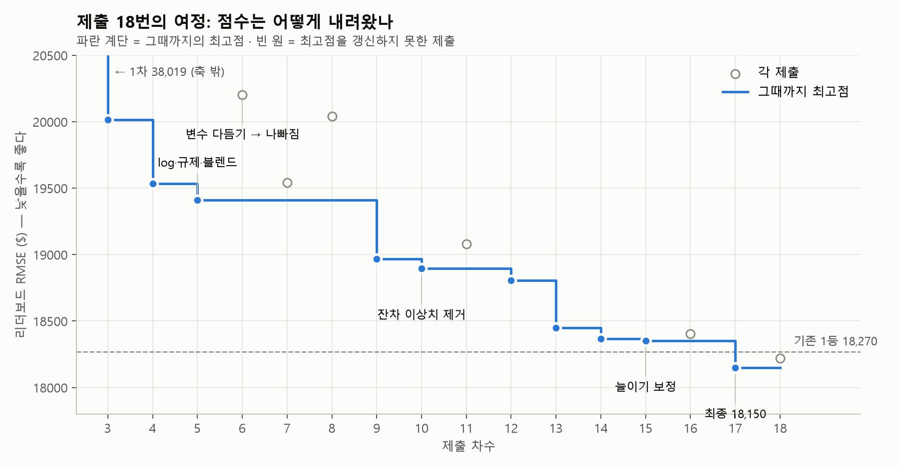
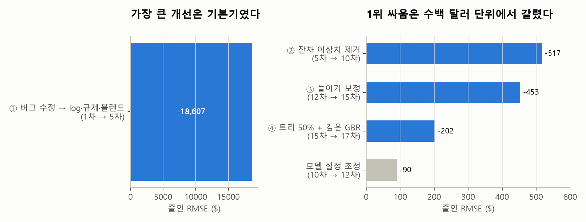
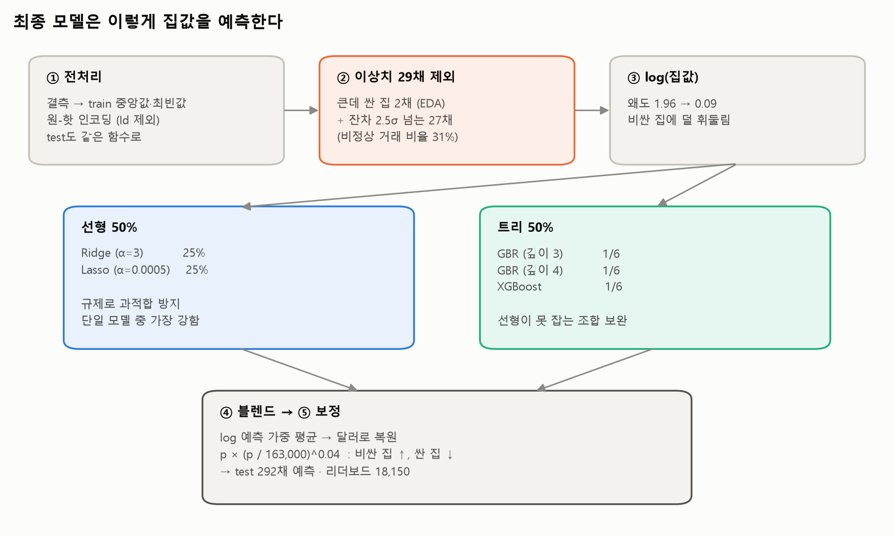
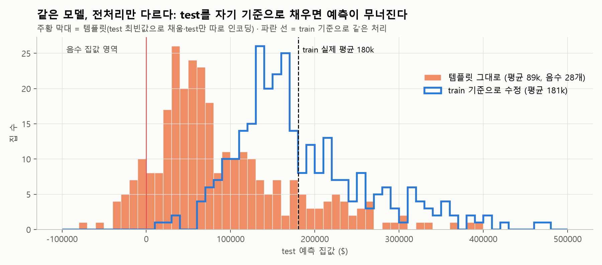
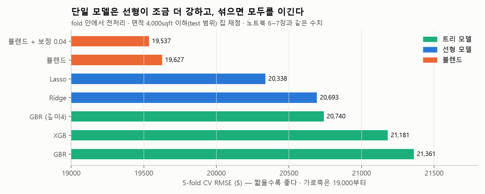
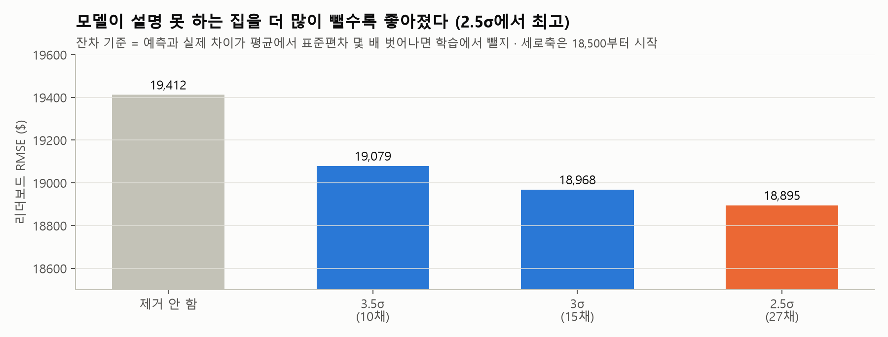
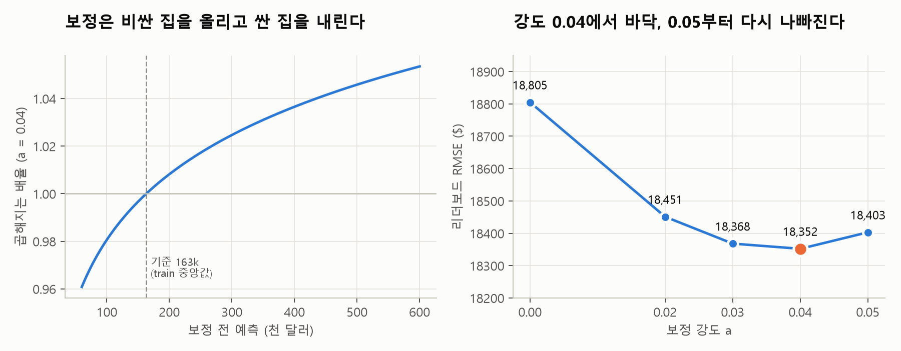
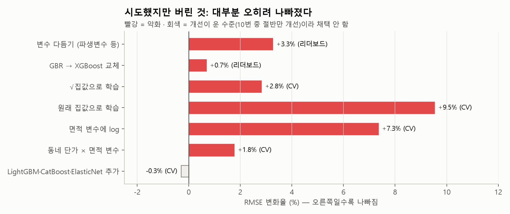

# 🏠 집값 예측 컴피티션: 회귀 모델 개선 기록(38,019에서 18,150까지)

**AI 데이터 인텔리전스 › 필수 머신러닝 › 집값 예측 컴피티션**

> [!CAUTION]
> **읽기 전에** — 이 문서는 **처음 과정(리더보드 튜닝)**의 기록이다. 이상치 기준·블렌드 비중·보정 강도를 리더보드 점수를 보고 골랐기 때문에, 18,150은 test 정보를 간접적으로 쓴 점수다.
> 공정하게 다시 고른 모델(리더보드 **20,215**, 1회 제출)은 `01_제출본/House_Prices_모델정리_공정검증본`을 본다. 두 점수의 차이(약 2,065달러)가 test에 맞춰 고른 효과다. 이 문서는 '무엇이 왜 문제였는지' 공부하는 반면교사 자료로 남긴다.

> **[Modulabs-DI2기] House Price Prediction** · 지표 RMSE(달러) · 리더보드는 test 292채 **전체**로 채점
>
> 코드와 실행 결과는 [`House_Prices_최종정리.ipynb`](이전_리더보드튜닝본/리더보드튜닝본_최종정리.ipynb)에 있다. 이 문서는 **무엇을, 왜 했는지**를 설명한다.

| | 리더보드 RMSE |
|---|---|
| 🔴 템플릿 그대로 | 예측 붕괴 (평균 8.9만 달러, 음수 28개) |
| 🟡 1차 제출 (버그 수정 후) | 38,019 |
| 🟢 **최종 (17차)** | **18,150** — 1차 대비 오차 **52% 감소**, 제출 당시 1위 |

---

## 0. 전 과정 한눈에 보기





> [!NOTE]
> **읽는 법** — 첫 번째 개선(버그 수정과 기본기)이 점수의 대부분을 줄였다. 그다음 1위 싸움은 **수백 달러 단위**의 개선(이상치, 보정, 트리 비중)이 쌓여서 결정됐다.
> 빈 원(6·8·11·16차)은 최고점을 갱신하지 못한 제출이다. 실패한 제출도 원인을 알려 주는 정보였다.

---

## 1. 한눈에 보는 최종 모델



> [!NOTE]
> **한 문장 요약** — 작은 정형 데이터(1,168채)에서는 **규제 선형 모델이 중심**이고, 트리 모델은 선형이 놓치는 부분을 보완한다.
> 점수를 크게 바꾼 것은 모델 종류가 아니라 **버그 수정 · 근거 있는 이상치 제거 · 예측 치우침 보정**이었다.

---

## 2. 점수를 바꾼 다섯 가지 결정

각 결정은 **문제 → 근거 → 행동 → 결과** 순서로 적었다.

### ① test 전처리 버그 수정 &nbsp; `붕괴 → 38,019`

> [!CAUTION]
> **문제** — 검증 RMSE는 39,487로 멀쩡한데 test 예측 평균이 8.9만 달러(train 평균 18만), 음수 28개였다.

- **원인 1**: test 결측을 **test 자신의** 최빈값으로 채웠다. `PoolQC`(수영장 품질)는 train 최빈값이 `Ex`, test 최빈값이 `Gd`다. test는 1채만 실제 값이 'Gd'이고 291채가 결측인데, 결측 291채가 'Gd'로 채워져 **292채 전부 '수영장 Gd'**가 됐고, 모델은 'Gd'를 학습 데이터 **단 1채**에서 배워 −64만 달러 계수를 갖고 있었다.
- **원인 2**: test만 따로 `get_dummies(drop_first=True)`를 했다. test에는 희귀 지붕재가 없어서 기준 범주가 바뀌었고, 대다수 집의 `RoofMatl_CompShg` 컬럼이 사라졌다.
- **행동**: 채우는 값은 train에서만 구하고, train과 test에 **같은 함수**를 적용한다.



```python
def preprocess(df):
    df = df.copy()
    df = df.fillna(train_raw.median(numeric_only=True))          # 숫자 빈칸 → train 중앙값
    for col in df.select_dtypes(include="object"):
        df[col] = df[col].fillna(train_raw[col].mode()[0])       # 글자 빈칸 → train 최빈값
    return df

test_X = pd.get_dummies(preprocess(test_raw))                    # test는 drop_first 없이
test_X = test_X.reindex(columns=X.columns, fill_value=0)         # train 컬럼에 정확히 맞춤
```

### ② log 타깃 + 규제 + 블렌드 &nbsp; `38,019 → 19,412`

> [!TIP]
> **근거 (EDA)** — 집값은 왜도 1.96으로 비싼 집 쪽 꼬리가 길다. log를 씌우면 0.09로 거의 대칭이 된다. 품질 점수 1점마다 집값 중앙값이 계단처럼 오른다(log 공간에서 거의 직선).

- **log 학습**: 소수의 비싼 집에 모델이 휘둘리지 않는다. 예측 후 `expm1`으로 달러를 복원한다.
- **규제(Ridge·Lasso)**: 원-핫 컬럼 240여 개 중 드문 범주에 극단적 계수가 붙는 과적합을 막는다(①의 −64만 달러 계수가 바로 그 예).
- **블렌드**: 선형과 트리는 틀리는 방식이 달라, 평균하면 오차가 상쇄된다.



### ③ 잔차 기반 이상치 제거 &nbsp; `19,412 → 18,895`

> [!IMPORTANT]
> **아이디어** — "모델이 도저히 설명하지 못하는 거래"는 배우지 않는다.

```python
check = make_pipeline(RobustScaler(), Ridge(alpha=10)).fit(X, log_y)   # 점검용 모델
resid = log_y - check.predict(X)                                       # 예측과 실제의 차이
z = (resid - resid.mean()) / resid.std()                               # 표준편차 몇 배인가
keep = z.abs() < 2.5                                                   # 2.5σ 넘으면 제외
```

| 기준 | 제외 | 리더보드 |
|---|---|---|
| 제거 안 함 | 0 | 19,412 |
| 3.5σ | 10채 | 19,079 |
| 3σ | 15채 | 18,968 |
| 🟢 **2.5σ** | **27채** | **18,895** |



- **근거 확인**: 제외된 29채 중 '비정상 거래(Abnorml)'는 9채(약 31%)로, 전체 train(약 7%)보다 **상대적으로 높다.** 잔차 기준이 정상 시세에서 벗어난 거래를 더 많이 골라냈다는 근거이지만, 제외된 집이 모두 비정상 거래인 것은 아니다(Normal도 10채).
- CV도 같은 방향이었고, 2σ에서는 다시 나빠졌다. **많이 빼되 지나치지 않게.**

### ④ 늘이기 보정 &nbsp; `18,805 → 18,352`

> [!TIP]
> **문제의식** — 규제 모델은 예측을 **평균 쪽으로 끌어당긴다.** 그래서 비싼 집은 싸게, 싼 집은 비싸게 예측한다. 달러 RMSE에서는 비싼 집의 오차가 크게 벌점을 받으므로 손해다.

$$\text{보정 예측} = p \times \left(\frac{p}{163{,}000}\right)^{a}$$



163,000달러(train 중앙값)보다 비싼 집은 올리고, 싼 집은 내린다. a=0.04면 60만 달러짜리 집이 약 +5%, 6만 달러짜리 집이 약 −4% 조정된다.

| a | 0 | 0.02 | 0.03 | 🟢 **0.04** | 0.05 |
|---|---|---|---|---|---|
| 리더보드 | 18,805 | 18,451 | 18,368 | **18,352** | 18,403 |

누수를 막은 노트북 CV에서는 보정 0.04가 5개 fold 중 4개에서 개선(평균 −90달러)됐지만 1개 fold는 나빠져, **효과의 확실한 입증은 리더보드 결과에 기대고 있다.**

### ⑤ 트리 비중 50% + 깊은 GBR &nbsp; `18,352 → 18,150`

선형 비중을 70%에서 50%로 줄이고, 깊이 4짜리 GBR을 추가했다. 트리는 규제로 인한 '평균 쪽 끌어당김'이 적어서, 보정과 같은 문제를 **모델 쪽에서도** 줄인다. 노트북 밖 반복 CV(5-fold × 3회, 비정상 2채 제외 기준)에서 19,689 → 19,423, 15번 중 14번 개선했다.

---

## 3. 최종 모델 코드 (핵심)

```python
WEIGHTS = {"Ridge": 0.25, "Lasso": 0.25, "GBR": 1/6, "GBR_d4": 1/6, "XGB": 1/6}
STRETCH = 0.04

class BlendModel:
    def fit(self, X, y):
        X_fit, logy_fit, self.n_removed = remove_outliers(X, y)   # 2채 + 잔차 2.5σ
        self.models = {
            "Ridge":  make_pipeline(RobustScaler(), Ridge(alpha=3)),
            "Lasso":  make_pipeline(RobustScaler(), Lasso(alpha=0.0005, max_iter=50000)),
            "GBR":    GradientBoostingRegressor(n_estimators=1500, learning_rate=0.03, max_depth=3,
                                                subsample=0.8, max_features="sqrt", random_state=42),
            "GBR_d4": GradientBoostingRegressor(n_estimators=2000, learning_rate=0.02, max_depth=4,
                                                subsample=0.8, max_features="sqrt",
                                                min_samples_leaf=5, random_state=42),
            "XGB":    XGBRegressor(n_estimators=2000, learning_rate=0.02, max_depth=3, subsample=0.8,
                                   colsample_bytree=0.3, min_child_weight=2, random_state=42),
        }
        for model in self.models.values():
            model.fit(X_fit, logy_fit)                              # 모두 log 집값을 학습
        return self

    def predict(self, X):
        X = X.drop(columns="Id")
        log_pred = sum(w * self.models[n].predict(X) for n, w in WEIGHTS.items())   # 블렌드
        price = np.expm1(log_pred)                                                 # 달러 복원
        return price * (price / 163000) ** STRETCH                                 # 늘이기 보정
```

| 구성 요소 | 왜 이것인가 |
|---|---|
| `RobustScaler` | 선형 모델은 컬럼 크기에 민감하다. 중앙값·사분위 기준이라 극단값에 덜 흔들린다 |
| `Ridge(α=3)` | 단독으로는 α=10이 조금 낫지만, **블렌드 안에서는** 규제를 약하게 한 α=3이 CV가 더 좋았다(예측을 덜 끌어당김) |
| `Lasso(α=0.0005)` | 쓸모없는 컬럼의 계수를 0으로 만든다. 단일 모델 중 1위(노트북 CV 20,338) |
| GBR 2개 + XGB | 선형이 못 잡는 조합(이 동네이면서 이 면적이면 …)을 보완한다 |
| `random_state=42` | 실행할 때마다 같은 결과가 나오게 고정한다(재현성) |

---

## 4. 시도했지만 버린 것

> [!WARNING]
> 버린 것도 결과다. **무엇이 안 됐는지**를 아는 것이 다음 분석의 시간을 줄인다.



| 시도 | 결과 | 판정 |
|---|---|---|
| 변수 다듬기 (None 범주, 품질 숫자화, 총면적·집 나이 등 파생변수) | CV −0.7%, **리더보드 +631** | 🔴 버림 — 고급 주택 가격을 과하게 올림 |
| GBR → XGBoost 교체 | 리더보드 +131 | 🔴 교체는 버림(블렌드엔 추가) |
| √(집값)·원래 집값으로 학습 (채점 기준에 맞추기) | CV +3~10% | 🔴 log가 여전히 최선 |
| 면적 변수에 log 적용 | CV +7% | 🔴 |
| 동네별 평당 단가 × 면적 변수 | CV +1.8% | 🔴 이미 원-핫·트리가 담고 있는 정보 |
| LightGBM · CatBoost · ElasticNet 추가 | CV −0.3% 이하, 절반의 fold만 개선 | 🟡 운 수준 → 채택 안 함 |
| SVR · KernelRidge | CV 22,900 이상 | 🔴 |

---

## 5. 검증 점수와 리더보드는 왜 다른가

| 검증 방법 | 데이터 | 쓰임 |
|---|---|---|
| 홀드아웃 | 234채 | 빠른 확인 |
| 5-fold 교차검증(CV) | 1,168채 (fold 안에서 전처리, 면적 ≤ 4,000sqft 집 채점) | 후보 거르기 |
| 리더보드 | test 292채 전체 | **최종 판정** |

> [!IMPORTANT]
> **외부 검수 후 바로잡은 검증 방법** — 처음 CV에는 두 가지 문제가 있었다.
> ① 결측 채움 값과 원-핫 컬럼을 **CV 전에 train 전체로** 정했다 → 검증 fold 정보가 전처리 기준에 섞인다(Ch4 데이터 누수).
> ② 채점에서 '아주 큰데 **싼** 집'을 뺐다 → **정답(가격)을 보고** 평가 대상을 고른 셈이다.
> 그래서 ① 각 fold의 학습 데이터만으로 전처리 기준을 정하고, ② 가격이 아니라 **면적(test 최대 3,627sqft) 기준으로 test 범위의 집**을 채점하도록 고쳤다.
> **검증 범위 명시** — 본 검증의 주요 CV 지표는 최종 예측 대상(test)의 면적 범위를 고려하여 4,000sqft 이하 주택에서 산출한 **조건부 성능**이며, 전체 주택에 대한 CV 결과는 별도로 제시하였다(노트북 4·6장). 이 범위는 test의 면적(피처) 분포를 보고 정했다. 정답 누수는 아니지만 평가 대상의 특성을 검증 설계에 반영한 것이다.
> 모든 집을 채점하면 선형 모델이 5만 달러대로 나빠지는데, test에 없는 4,000sqft 초과 4채에서 선형 모델이 크게 빗나가기 때문이다(외삽). 결론(선형 > 트리, 블렌드 > 단일, 보정 효과 있음)은 바뀌지 않았다.

1. **채점하는 집이 다르다.** RMSE는 오차를 제곱하므로 비싼 집 몇 채가 점수를 좌우한다. 어느 쪽에 고가 주택이 몇 채 있느냐에 따라 같은 모델도 수백~수천이 달라진다.
2. **6차의 역전** — CV는 '변수 다듬기'가 좋다고 했지만 리더보드는 나빠졌다. 두 가지를 동시에 바꿔서 원인을 몰랐다. 그래서 **하나씩만 바꾼 원인분석 제출**(7·8차)로 범인을 특정했다.
3. **보정 강도** — 누수를 막은 5-fold CV에서는 0.02~0.03이 최저(19,488), 리더보드에서는 0.04가 최저다. 다만 CV에서 보정 0.04의 효과는 5개 fold 중 4개에서만 나타났고(평균 −90달러, 한 fold는 +880), fold 간 편차가 평균 개선보다 커서 **CV만으로는 효과가 확실하다고 말할 수 없다.** 채택의 근거는 리더보드 결과다. test의 고가 주택 비중이 더 커서 보정 효과가 더 크게 나타난 것으로 본다.

> [!CAUTION]
> **정직한 기록** — 보정 강도 0.04와 이상치 기준 2.5σ는 **리더보드 점수를 보고 최종 선택**했다(test에 맞춘 튜닝).
> 이 대회는 리더보드가 test 전체로 매기는 최종 점수라 순위에는 유효하다. 하지만 새로운 데이터에서 같은 값이 최적이라는 보장은 없다.
> 방향(보정이 도움 된다, 이상치를 빼면 좋아진다)은 CV와 리더보드가 일치한다.

---

## 6. 학습자로서, 분석가로서 배운 것

> [!IMPORTANT]
> **1. 제출 전에 예측값을 상식으로 점검한다.**
> 검증 점수가 멀쩡해도 파이프라인은 고장 날 수 있다. `describe()` 한 줄(평균, 최솟값, 음수 개수)이 1차의 붕괴를 잡았다.

> [!IMPORTANT]
> **2. train과 test는 같은 함수, train의 통계로 처리한다.**
> test를 자기 기준으로 채우거나 인코딩하면 컬럼의 의미가 달라진다. Ch4 '데이터 누수'의 반대 방향 버전이다.

> [!TIP]
> **3. 노트북의 상태는 화면 위치가 아니라 실행 순서가 결정한다.**
> `[n]` 번호를 보는 습관을 들인다. 최종본은 **Restart → Run All**로 위에서부터 한 번에 돌아가야 한다.

> [!TIP]
> **4. 한 번에 하나만 바꿔야 원인을 안다.**
> 두 가지를 함께 바꾼 6차는 왜 나빠졌는지 몰랐다. 하나씩 바꾼 원인분석 제출이 범인을 찾았다.

> [!NOTE]
> **5. 작은 정형 데이터에서는 규제 선형 모델이 강하다.**
> "Kaggle이면 부스팅"은 공식이 아니다. 데이터 크기와 관계의 모양(EDA)을 보고 고른다.

> [!NOTE]
> **6. 이상치는 근거를 갖고 뺀다.**
> 눈으로 본 근거(EDA: 크기 대비 가격, 공사 중 판매) → 통계적 기준(잔차 2.5σ) → 결과 확인(제외된 집 중 비정상 거래 비율) 순서로 판단했다.

> [!WARNING]
> **7. CV와 리더보드가 엇갈리면 기록하고 설명한다.**
> 리더보드로 고른 값은 '리더보드로 골랐다'고 적는다. 좋은 점수보다 **설명할 수 있는 선택**이 분석가의 자산이다.

> [!IMPORTANT]
> **8. 검증도 test와 같은 조건으로 한다.**
> CV 안에서도 전처리 기준은 fold의 학습 데이터로만 정한다(Ch4). 채점에서 뺄 집은 정답(가격)이 아니라 test에서도 알 수 있는 정보(면적 범위)로 정한다. 외부 검수에서 지적받아 바로잡았다.

---

## 7. 작업 방식과 재현 방법

**AI 활용** — 실험 설계와 코드 작성에 AI(Claude)를 함께 사용했다. 대회 규칙("AI 코드도 한 줄씩 이해하고 검증")에 따라, 최종 코드는 노트북에 주석과 함께 정리했고 각 결정의 근거를 이 문서에 남겼다.

**재현 범위** — 노트북만으로 재현되는 것은 노트북 출력(EDA, 단일 모델 CV, 블렌드·보정 CV)과 최종 제출 파일이다. '시도했지만 버린 것'의 CV 수치와 ⑤의 반복 CV 수치는 노트북 밖 실험 스크립트로 얻은 **실험 기록**이며, 그 코드는 제출물에 포함하지 않았다.

**재현** — `modulabs-di/01_제출본` 폴더에서 아래 순서로 실행한다(데이터는 상위 `modulabs-di` 폴더에 있다).

1. [`House_Prices_최종정리.ipynb`](이전_리더보드튜닝본/리더보드튜닝본_최종정리.ipynb)를 열고 **Restart → Run All** (약 2분 30초)
2. `submission_final.csv`가 생성된다. 17차 제출과 1센트 미만 차이다(부동소수점 오차).

| 파일 | 내용 |
|---|---|
| `01_제출본/House_Prices_최종정리.ipynb` | 전체 과정 코드 + 근거 그래프 + 제출 이력 (11개 섹션) |
| `01_제출본/House_Prices_모델정리_AI활용수정본.md·pdf` | 제출용 문서 |
| `02_학습용/House_Prices_모델정리(본인 학습용).md·pdf` | 학습용 문서 |
| `01_제출본/submission_final.csv` | 노트북이 만드는 최종 제출 파일 |
| `제출기록/17차_18150_…csv` | 실제로 제출한 17차 파일 |
| 환경 | Python(myenv) · scikit-learn 1.9 · pandas 3.0 · xgboost 3.4 |

---

<div class="signature" align="right"><b>[AI 데이터 인텔리전스 박근아]</b></div>
